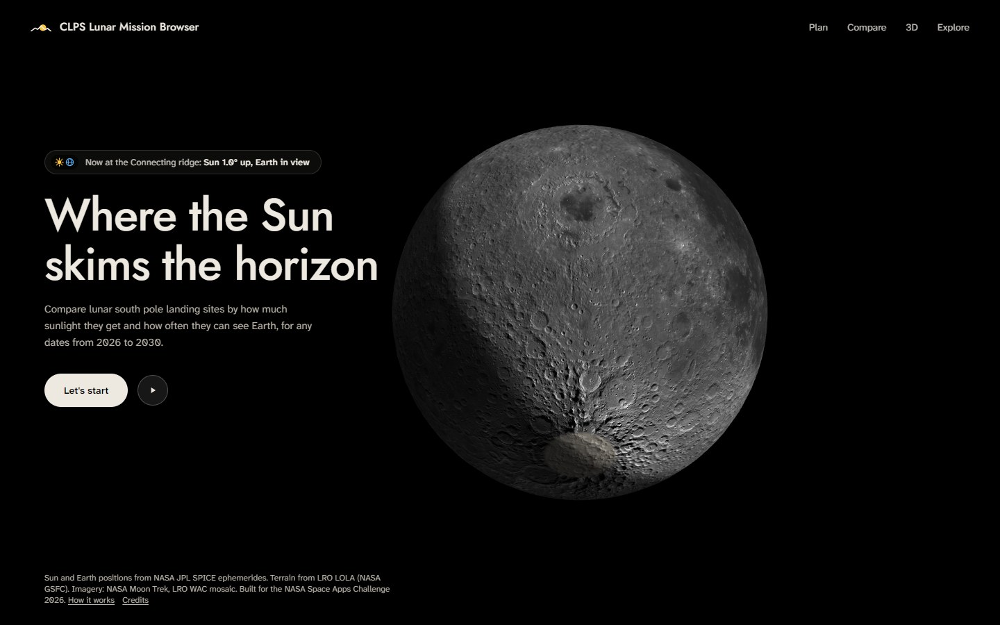
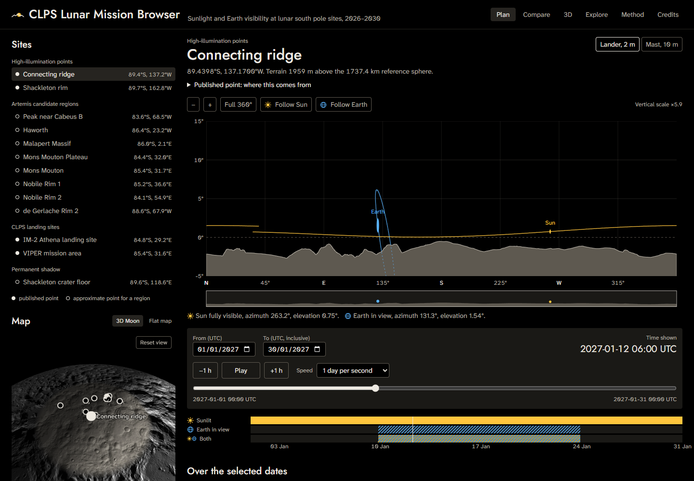
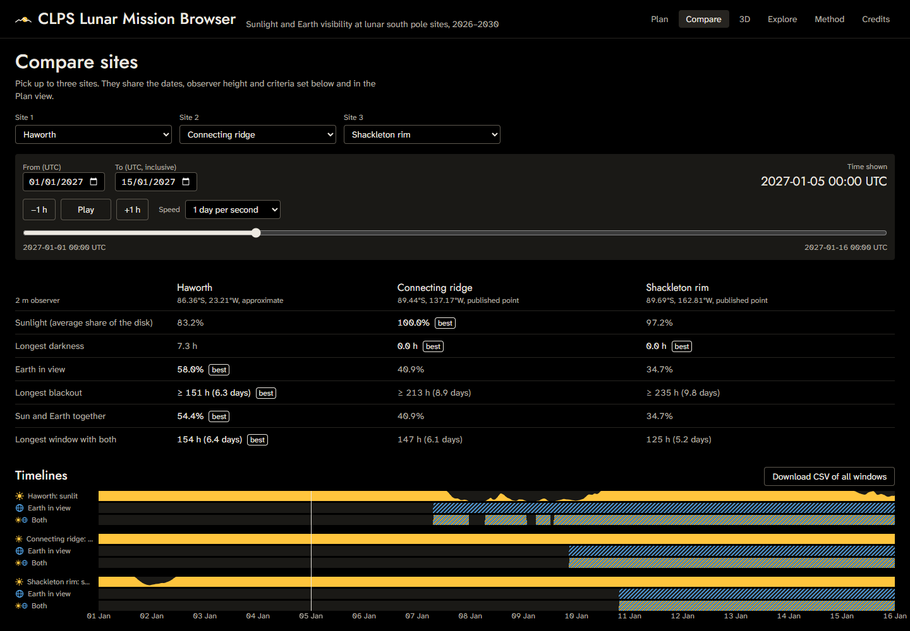
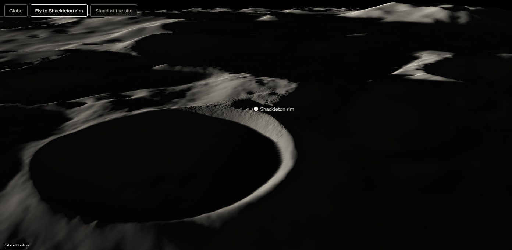
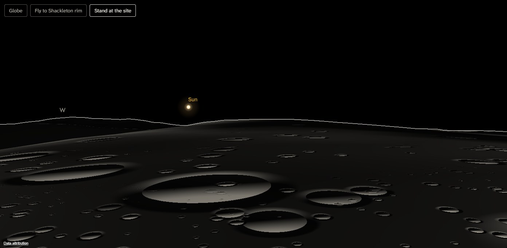
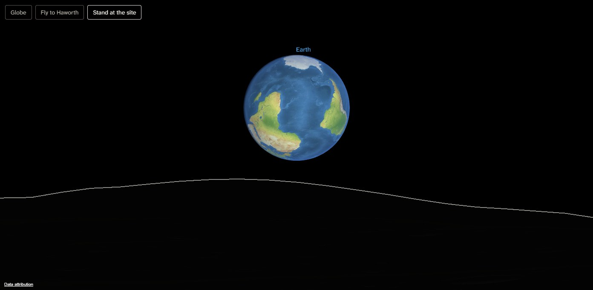
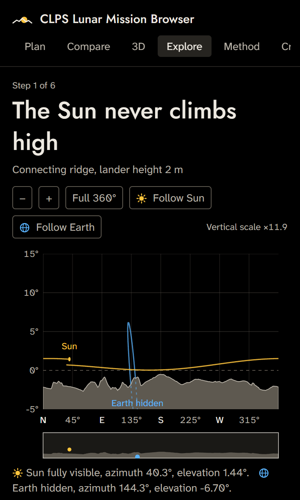

# CLPS Lunar Mission Browser

**Pick a lunar south pole site and a date range. See when it has sunlight, when it can see Earth, and how it compares to other sites.**

### [Open the live site →](https://clps-lunar-mission-browser.vercel.app)

<a href="https://clps-lunar-mission-browser.vercel.app"></a>

Built for the NASA Space Apps Challenge 2026, challenge *CLPS Lunar Mission Browser*. Source code: [github.com/BroBYW/CLPS-Lunar-Mission-Website](https://github.com/BroBYW/CLPS-Lunar-Mission-Website).

## The problem

Missions to the Moon's south pole face extreme light and communication constraints. The Sun never climbs more than a couple of degrees above the horizon. A ridge a few hundred metres high can be lit for most of the year, while a crater floor nearby never sees the Sun. Earth drifts up and down near the horizon, so a direct radio link to Earth comes and goes.

Tools that give the Sun's and Earth's positions exist, but they are hard to use for comparing landing sites and dates. Mission planners, educators and the public need something quicker.

## What it does

| View | What you get |
|---|---|
| **Home** | A live 3D Moon lit by the Sun as it is right now. "Let's start" flies you down to the south pole. |
| **Plan** | Pick one of 14 cited sites on a list or a polar map, or **drop a pin** anywhere south of 82°S for a rough horizon there. **Replay a real landing**: IM-1 Odysseus (2024) and IM-2 Athena (2025) at their real sites and times, or **watch Earth eclipse the Sun** during any lunar eclipse of 2024–2030, timed for the site. The horizon panorama shows the terrain skyline with the Sun's and Earth's paths over your dates and their true-size disks at the chosen moment; press **Listen** to hear the skyline as a sound sweep, or on a phone **Look around** to turn the panorama with the phone's compass. Time controls are in UTC, 2024–2030. Below it: metrics, a sunlit / Earth / both timeline, **Deep Space Network contact** (when a dish on Earth can see the Moon too), overlap windows as CSV, a power and battery calculator, a **mast planner** that shows how much a 2–50 m mast adds, and **a real LRO photo** of the 48 km around the site beside the app's own terrain lit for that same moment, plus a **shadow movie** of that ground over your dates that you can save as a video. |
| **Compare** | Two or three sites side by side, with the best value in each row marked and the timelines aligned. |
| **Find dates** | Every site and every start date in a year, scored for a 3- to 28-day mission. Set limits for sunlight, darkness and Earth contact; a heatmap shows which windows meet them and a table lists the best. |
| **3D** | Fly to any site to see the LOLA terrain around it (7.5 m detail near the site, out to 300 km), lit by the Sun at the chosen time with shadows cast by the terrain itself. Then stand on it: the Sun, and a textured Earth lit and turned for that moment, sit over the computed skyline. Plan a **rover drive** by clicking waypoints and see where it keeps the Sun and Earth, and download the terrain as a **3D-print file** (STL). Standing at a site, make an **Earth postcard**: the best moment in the next month to see Earth just over the skyline, framed and captioned. |
| **Explore** | A six-step story for classrooms, from the low Sun to libration, ending with a landing-site challenge. It works on phones. |
| **Play** | Games on the same data. **Survive the lunar night**: build a lander on a budget and keep it alive through a real month at a real site, sending science home while Earth is up. A **daily landing challenge**, the same mission for everyone each day, scored against the best landing of the year. A **photo quiz**: which is LRO's photo and which the app's model, and which way was the Sun? And **Outrun the shadows**: drive a rover on the 3D terrain while time races and shadows sweep across it. |
| **Method, Credits** | How it works, its limitations, and every data source. |

Every view has a shareable URL. The site, dates, time, observer height and criteria all live in the query string.

## Screenshots

Click a picture to open that view on the live site.

<table>
  <tr>
    <td width="50%" valign="top">
      <a href="https://clps-lunar-mission-browser.vercel.app/?site=connecting-ridge&amp;from=2027-01-01&amp;to=2027-01-30&amp;t=2027-01-12T06:00Z&amp;h=2"></a>
      <br><b>Plan.</b> The Connecting ridge in January 2027: the horizon panorama with the Sun's and Earth's paths, the site list and map, and the timeline of sunlight and Earth in view.
    </td>
    <td width="50%" valign="top">
      <a href="https://clps-lunar-mission-browser.vercel.app/?view=compare&amp;site=haworth&amp;cmp=haworth,connecting-ridge,shackleton-rim&amp;from=2027-01-01&amp;to=2027-01-15&amp;t=2027-01-05T00:00Z&amp;h=2"></a>
      <br><b>Compare.</b> Haworth, the Connecting ridge and Shackleton rim over 1–15 January 2027, with the best value in each row marked.
    </td>
  </tr>
  <tr>
    <td width="50%" valign="top">
      <a href="https://clps-lunar-mission-browser.vercel.app/?view=3d&amp;site=shackleton-rim&amp;from=2027-01-01&amp;to=2027-01-31&amp;t=2027-01-12T06:00Z&amp;h=2"></a>
      <br><b>3D terrain.</b> Shackleton crater on 12 January 2027. Its floor stays in permanent shadow while the far wall and nearby peaks catch the low Sun. Press <i>Fly to</i> on the page.
    </td>
    <td width="50%" valign="top">
      <a href="https://clps-lunar-mission-browser.vercel.app/?view=3d&amp;site=shackleton-rim&amp;from=2027-01-01&amp;to=2027-01-31&amp;t=2027-01-12T06:00Z&amp;h=2"></a>
      <br><b>Standing on the rim</b> at the same moment, with the Sun 0.9° up and clear of the skyline. The thin line is the computed horizon that every number uses. Press <i>Stand at the site</i>.
    </td>
  </tr>
  <tr>
    <td width="50%" valign="top">
      <a href="https://clps-lunar-mission-browser.vercel.app/?view=3d&amp;site=haworth&amp;from=2027-01-01&amp;to=2027-01-31&amp;t=2027-01-08T13:00Z&amp;h=2"></a>
      <br><b>Full Earth over Haworth,</b> 8 January 2027 at 13:00 UTC, lit and turned for that hour. Seen from the Moon's south pole, Antarctica is at the top.
    </td>
    <td width="50%" valign="top" align="center">
      <a href="https://clps-lunar-mission-browser.vercel.app/?view=explore&amp;site=connecting-ridge&amp;from=2027-01-01&amp;to=2027-01-15&amp;t=2027-01-05T00:00Z&amp;h=2"></a>
      <br><b>Explore on a phone.</b> Step 1 of the six-step story.
    </td>
  </tr>
</table>

## Metrics

All metrics are computed over your dates on a 10-minute grid.

- **Sunlight:** the time-averaged share of the Sun's disk above the terrain. Earth eclipsing the Sun is included.
- **Longest darkness:** the longest stretch with no Sun visible. The threshold is adjustable.
- **Earth in view:** the share of time Earth's center clears the terrain. The margin is adjustable.
- **Longest communication blackout.**
- **Windows with both:** stretches with sunlight and Earth in view together.
- **Power and battery:** a vertical, Sun-tracking panel, P = 1361 W/m² × (1 AU / r)² × efficiency × area × visible fraction × cos(elevation). Battery size comes from an energy-balance simulation, shown next to the simple load × longest-darkness estimate.

## How it works

```
Python pipeline (run once)                          Static web app (Vercel, no backend)
  NAIF SPICE kernels ──► hourly Sun/Earth vectors ──► ephemeris.bin (1 MB)  ─┐
  LRO LOLA 10–240 m ───► horizon masks, 3,600 az ───► horizons.bin (0.4 MB) ─┼─► React + Web Worker
  sites.yaml (cited) ──► resolved site points ──────► sites.json            ─┤   az/el, disk fraction,
  LOLA 80 m ───────────► hillshade basemap ─────────► basemap-south.webp    ─┤   metrics, battery
  LOLA 7.5 m–1.5 km ───► 3D terrain grids ──────────► terrain/*.bin.gz      ─┘
  JPL Horizons API ◄──── validation                                              CesiumJS (lazy) for 3D
```

- **Ephemeris:** SPICE `spkpos` with light-time and stellar aberration corrections, in the lunar mean-Earth/polar-axis frame (MOON_ME, the frame LOLA uses), DE440, hourly from 2024 to 2031.
- **Horizons:** rays every 0.1° of azimuth out to 300 km, using exact spherical geometry, from 2 m and 10 m observers. They use NASA Goddard's LOLA maps (Barker et al. 2023): 10 m near each site, 20, 80 and 240 m farther out.
- **In the browser:** the app interpolates the vectors, subtracts the site position and rotates into local east-north-up. It then computes the visible share of each disk against the horizon, in a Web Worker. Five years at 10-minute steps take about 0.1 s.

## Accuracy

Full details and reproduction steps are in [VALIDATION.md](VALIDATION.md).

| Check | Result |
|---|---|
| Browser vs Python pipeline (Vitest, 144 cases) | within 0.0001° |
| Python vs NASA JPL Horizons, 3 sites × 5 dates | within 0.00001° |
| Horizon code on synthetic terrain | exact to 0.0002° (sphere), 0.02° (mesa) |
| Sunlight at Gläser et al. 2014/2018 points (LOLA, 2 m and 10 m) | within 1.5 percentage points; longest darkness within about 2 h |
| Earth visibility vs NASA PGDA maps | within 5 points at 17 of 21 points |
| 3 Mar 2026 total lunar eclipse | darkness timings fit NASA's contact times |
| Eclipses found in the browser vs the SPICE pipeline | 15 eclipses in 2024–2030 at NASA's times; Malapert's 3 Mar 2026 timings within 2 minutes |
| Accessibility (axe-core, WCAG 2.1 AA) | 0 violations on every view |
| Performance | first load about 1 s on broadband; 60+ fps playback |
| 3D terrain sunlight vs the horizon masks, 14 sites × 28 days | agree 99.8% of the time |
| Sites sunlit or in shadow vs 1,022 LRO Wide Angle Camera photos (2009–2011) | agree in 99.3% of 2,281 photos that can tell |
| The app's lit terrain vs 28 full-resolution LRO photos | 98.3% of 62,221 km² agree |

## Run it locally

You need Node 22 or later, and [uv](https://docs.astral.sh/uv/) for the pipeline.

```bash
git clone https://github.com/BroBYW/CLPS-Lunar-Mission-Website.git
cd CLPS-Lunar-Mission-Website/web
npm install
npm run dev
```

The derived data is committed in `web/public/data/`, so the app runs without the pipeline. Tests and a production build:

```bash
npm test
npm run build
```

The 3D views need no API key. The optional Cesium ion Moon terrain is not enabled.

## Rebuild the data

From `pipeline/`:

```bash
uv sync
uv run python scripts/fetch_kernels.py      # SPICE kernels, 46 MB
uv run python scripts/ephemeris.py          # ephemeris.bin
uv run python scripts/dsn.py                # dsn.bin, Moon elevation at the Deep Space Network dishes
uv run python scripts/fetch_dems.py         # LOLA windows and far maps, about 1.3 GB (see --dry-run)
uv run python scripts/sites.py              # resolve site points
uv run python scripts/fetch_dems.py         # top up 10 m coverage around moved points
uv run python scripts/horizon.py            # horizons.bin, sites.json, mask plots
uv run python scripts/mast_horizons.py      # horizons-mast.bin, for the mast planner
uv run python scripts/basemap.py            # basemap-south.webp, polar-cap-south-[we].webp
uv run python scripts/terrain_patches.py    # 3D terrain grids, terrain/*.bin.gz
uv run python scripts/pin_dem.py            # pin-dem.bin.gz, the 480 m grid for dropped pins
uv run python scripts/lro_photos.py         # LRO photo check and lro/*.webp, about 450 MB at one request per 4 s
uv run python scripts/earth_texture.py      # earth.jpg (run npm install in web/ first)
uv run python scripts/export_fixtures.py    # Vitest fixtures
uv run python scripts/validate_horizons.py  # JPL Horizons comparison
uv run python scripts/validate_eclipse.py
uv run python scripts/validate_literature.py
uv run pytest
```

Raw elevation maps and kernels are downloaded into `pipeline/raw/` and `pipeline/kernels/`; both are git-ignored. Downloads from NASA's servers can be slow (around 100 KB/s), and the windowed reads are resumable.

The home page Moon is built from NASA's SVS `moon_small.glb` and the LOLA global map `LDEM_16.IMG` (both linked in DATA_SOURCES.md). Put them in `3d_models/` and `pipeline/raw/`, then from `web/`:

```bash
node scripts/compress-moon-model.mjs ../3d_models/moon_small.glb ../pipeline/raw/LDEM_16.IMG
```

## Limitations

In short:
- Terrain detail below about 20 m is not modelled. In the 3D standing view, the small craters and surface texture near your feet are decorative.
- Region points are approximate: NASA publishes region footprints, not points.
- Earth visibility is geometric and ignores Deep Space Network coverage and link budgets.
- The power model ignores dust and temperature.
- Dates are limited to 2024–2030.

See the in-app **Method** page and [VALIDATION.md](VALIDATION.md) for the full list.

## Data and credits

The data comes from:
- NASA JPL NAIF SPICE
- JPL Horizons
- LRO LOLA, through NASA Goddard PGDA and the PDS Geosciences Node
- LROC and NASA Moon Trek
- the IAU Gazetteer of Planetary Nomenclature
- NASA's Artemis landing regions

Full citations are in [DATA_SOURCES.md](DATA_SOURCES.md) and the in-app **Credits** page. This project isn't endorsed by NASA and uses no NASA logos.

## AI use

Parts of the code and documentation were written with Claude (Anthropic). [AI_USAGE.md](AI_USAGE.md) records what it did at each step.

## Notes

`npm audit` reports issues only in development tools, inside the Vercel CLI's dependencies used for deploying. Production dependencies have none.

## License

[MIT](LICENSE)
